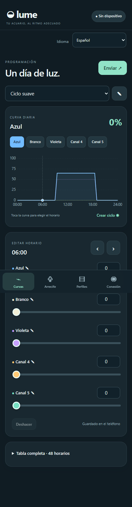

# ◒ Lume

[Português (Brasil)](README.md) · [English](README.en.md) · **Español**

> **Creado con vibe coding para resolver un problema real, sin fines de lucro.** Lume es un proyecto personal, independiente, gratuito y de código abierto para facilitar el uso de una controladora antigua de iluminación de acuario. Se desarrolló con amplia asistencia de Codex, de OpenAI, guiado por los requisitos y las pruebas de un usuario con el aparato real.

**Un día de luz, del amanecer al anochecer.**

Editor para controladoras de acuario compatibles con TC420 y módulos Wi-Fi Pled V2.2/Smart Timer. Aplicaciones para **Windows y Android**, con curvas de cinco canales, perfiles y un arrecife animado que sigue la programación.

Las aplicaciones incluyen **portugués, inglés y español**. Al abrir por primera vez, usan el idioma del dispositivo. El selector **Idioma** permite elegir otro o volver a **Automático (dispositivo)**. La elección se guarda; otros idiomas del sistema usan inglés como alternativa. Cambiar el idioma no traduce ni modifica los nombres guardados de perfiles o canales.

> **Versión preliminar:** el usuario confirmó la búsqueda en Android y comunicó buenos resultados tras la 1.0.5. Los idiomas se verificaron localmente, en navegador y con renderizado de Windows. La nueva versión aún necesita pruebas en el teléfono y la controladora. No hay lectura completa de la memoria del aparato. [Evidencia de compatibilidad, en inglés](docs/en/COMPATIBILITY.md).

## Descargar e instalar

| Aplicación | Descarga | Instalación |
|---|---|---|
| Windows x64 · 0.6.0 | [ZIP completo con .NET](https://github.com/eifoxy/lume/releases/download/windows-v0.6.0/Lume-Windows-0.6.0-win-x64.zip) | Extrae todo y abre `Lume.exe`. |
| Windows · 0.6.0 | [ZIP ligero](https://github.com/eifoxy/lume/releases/download/windows-v0.6.0/Lume-Windows-0.6.0-portable.zip) | Requiere .NET Desktop Runtime 8. Extrae todo y abre `Lume.exe`. |
| Android 8+ · 1.2.0 | [APK](https://github.com/eifoxy/lume/releases/download/android-v1.2.0/Lume-Android-1.2.0.apk) | Descarga en el teléfono y abre el archivo. |
| iPhone/iPad · iOS 15.4+ · 0.1.1 | [Versión de desarrollo](https://github.com/eifoxy/lume/actions/workflows/ios.yml) | Sin firma, no se instala al descargar. [Guía iOS](docs/es/INSTALACION-IOS.md). |

En Android, actualiza **sobre la versión anterior, sin desinstalar**, para conservar los perfiles. En Windows, exporta una copia de la biblioteca antes de actualizar. [Instalación detallada](docs/es/INSTALACION.md) · [Versiones y sumas SHA-256](https://github.com/eifoxy/lume/releases).

**iOS en desarrollo:** editor, tres idiomas y funciones Wi-Fi portados, incluida la vista previa Smart Timer en la luminaria. Búsqueda mediante consultas directas en la red local e IP conocida. Faltan pruebas con iPhone/controladora reales y firma Apple para instalar. No hay TestFlight/App Store. [Instalación y límites](docs/es/INSTALACION-IOS.md).

## Vista previa en la luminaria

En Arrecife, usa **Vincular luminaria** para que una Smart Timer siga el horario y la reproducción acelerada por Wi-Fi. Se activa con confirmación; enviar perfiles no la activa automáticamente. Al finalizar o salir del primer plano, el app intenta reanudar el programa y conserva un aviso si no se confirma. No hay confirmación de cada intensidad ni lectura de la luz física. [Uso y límites](docs/es/VISTA-EN-VIVO.md). Falta probar la nueva función en el aparato real.

## Funciones

- Cinco canales y **48 horarios diarios**, con intensidades enteras de 0 a 100% y vista previa interpolada, incluso al pasar la medianoche.
- Curvas por canal, controles deslizantes, valores numéricos y tabla. Windows permite dibujar, ampliar y aislar curvas.
- Asistente de amanecer y anochecer con rampas y máximos por canal.
- Biblioteca local: crear, renombrar, duplicar, eliminar, deshacer e importar JSON/LMF.
- Envío de un perfil o sustitución completa por hasta 16 perfiles, con revisión y confirmación explícita antes de borrar.
- Búsqueda Wi-Fi, búsqueda por IP, configuración del router, envío de horarios, sincronización del reloj y reanudación.
- Búsqueda automática en Android al abrir o regresar. Recuerda la controladora por identificador aunque cambie su IP y vuelve a buscar si no responde.
- Arrecife animado: los corales se abren con la luz simulada y tres peces payaso nadan por el acuario.
- Guardado atómico y copia local antes del envío. La copia no lee la memoria de la controladora.
- Sin cuenta ni nube. Edición sin conexión; comunicación local por Wi-Fi o USB en Windows.
- Idioma automático o manual, guardado por aplicación.

## Diferencias entre plataformas

| Función | Windows | Android |
|---|:---:|:---:|
| Curvas, tabla, ciclos, perfiles y arrecife | Sí | Sí |
| Portugués, inglés y español | Sí | Sí |
| Configuración y envío por Wi-Fi | Sí, protocolo de escritorio | Sí, incluye Smart Timer |
| Búsqueda y reconexión automáticas | No | Sí |
| USB HID | Sí | No |
| Ajuste instantáneo de los LED físicos | USB, experimental | Vista previa Wi-Fi, Smart Timer |
| Importar LMF / JSON | Sí | Sí |
| Importar proyectos LCM | Sí | No |
| Exportar LMF / JSON | Sí | JSON |

Windows 0.6.0 conserva el transporte de Windows 0.5.0; añadir idiomas no incorpora la adaptación Smart Timer `88 00` de Android.

## Primer uso por Wi-Fi

1. Conecta el PC o teléfono al Wi-Fi creado por el aparato y permanece conectado aunque no haya internet.
2. Android busca automáticamente; elige una controladora si hay varias. En Windows, abre **Conectar por Wi-Fi** e inicia la búsqueda.
3. Envía el nombre y la contraseña de la red de casa, con seguridad compatible con el módulo.
4. Conecta el PC o teléfono a esa red. Regresa a Lume en Android o vuelve a buscar en Windows.
5. Revisa el perfil, sincroniza el reloj y envía la programación.

Se necesita **hardware Wi-Fi compatible**. Una TC420 sin módulo inalámbrico no obtiene Wi-Fi mediante software. Android funciona exclusivamente por Wi-Fi. [Guía de red](docs/es/WIFI.md).

## Vista previa

Captura de la interfaz en español, renderizada en navegador. La animación es ilustrativa: no mide PAR, espectro ni respuesta biológica y, sin vínculo en vivo, no modifica la luz física.

## Documentación

- [Instalación y selección de idioma](docs/es/INSTALACION.md)
- [Wi-Fi y solución de problemas](docs/es/WIFI.md)
- [Curvas, perfiles y envíos](docs/es/USO.md)
- [Compilar, probar y mantener traducciones](docs/es/DESARROLLO.md)
- [Compatibilidad y validación, en inglés](docs/en/COMPATIBILITY.md)
- [Arquitectura y protocolo, en inglés](docs/en/PROTOCOL.md)
- [Análisis del APK original, en inglés](docs/en/SMART-WIFI-TIMER-ANALYSIS.md)
- [Historial, en inglés](CHANGELOG.md)
- [Contribuir, en inglés](CONTRIBUTING.md)

## Autoría y licencia

Creado y mantenido por [eifoxy](https://github.com/eifoxy), responsable de la idea, requisitos y pruebas con el aparato. **Codex, asistente de IA de OpenAI**, colaboró en la implementación, el análisis del protocolo, las pruebas y la documentación. No representa una cuenta personal de GitHub ni un respaldo oficial de OpenAI.

Código y dibujos bajo la [licencia MIT](LICENSE). El propósito sin fines de lucro no añade restricciones a esa licencia. No se distribuyen binarios propietarios, código decompilado, claves de firma ni bibliotecas personales. Proyecto independiente, sin afiliación con los fabricantes.
