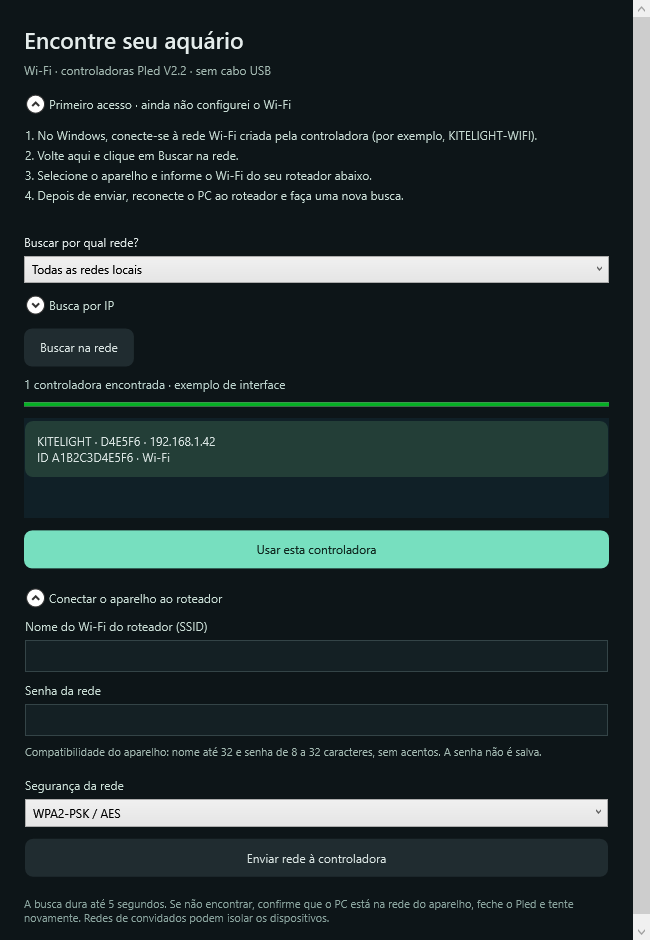

# Instalar no Windows

**Português (Brasil)** · [English](en/INSTALL-WINDOWS.md)

[← Início](../README.pt-BR.md) · [Configuração Wi-Fi](WIFI.md) · [Uso e perfis](USO.md)

## Idioma

O seletor na barra lateral permite Português (Brasil), English, Español ou Automático (dispositivo), que segue o idioma do Windows. A preferência fica em `data/language.json` e não altera seus perfis. [Guia em espanhol](es/INSTALACION.md).

## Requisitos e download

- Windows 10/11 de 64 bits para o pacote `win-x64`.
- Uma pasta na qual seu usuário possa salvar arquivos.
- Controladora compatível por USB HID ou com módulo Wi-Fi compatível para conexão sem fio.

Abra a [página de versões](https://github.com/eifoxy/lume/releases/tag/windows-v0.7.0). Existem dois pacotes:

| Arquivo | Qual escolher |
|---|---|
| `Lume-Windows-0.7.0-win-x64.zip` | Inclui o .NET. É a opção mais simples para Windows x64. |
| `Lume-Windows-0.7.0-portable.zip` | Download menor. Requer o **.NET Desktop Runtime 8 para Windows**, da [Microsoft](https://dotnet.microsoft.com/en-us/download/dotnet/8.0). O runtime básico ou ASP.NET sozinho não substitui o Desktop Runtime. |

1. Baixe o ZIP escolhido.
2. Clique com o botão direito e escolha **Extrair tudo**.
3. Guarde a pasta, por exemplo, em Documentos. Evite abrir direto de dentro do ZIP ou colocar em uma pasta que exige administrador.
4. Abra `Lume.exe`. No pacote leve, mantenha os arquivos `.dll` e `.json` junto do executável.
5. O primeiro uso começa com um ciclo de exemplo; ajuste-o antes de enviá-lo.

O aplicativo é portátil: não há instalador nem necessidade de privilégios de administrador. A distribuição atual não possui certificado comercial de assinatura de executável. Baixe pela página oficial deste repositório e compare o SHA-256 com `SHA256SUMS.txt` se quiser conferir o arquivo:

```powershell
Get-FileHash .\Lume-Windows-0.7.0-win-x64.zip -Algorithm SHA256
```

## Conectar por USB

1. Feche o Pled e outros aplicativos que possam estar usando a controladora.
2. Conecte o cabo USB e clique em **Buscar TC420**.
3. Confira a identificação encontrada. Há caminhos distintos para TC420 clássica e a variante Pled V2.2.
4. Edite um perfil. **Enviar à TC420** abre a revisão do perfil e da posição antes de gravar.

O Lume usa HID nativo do Windows e não exige trocar o driver por ferramentas externas. O cabo pode precisar transportar dados, além de fornecer energia. Uma detecção bem-sucedida não comprova que todos os comandos funcionem no firmware. Veja a [compatibilidade](COMPATIBILIDADE.md).

**Aplicar este instante aos LEDs** envia intensidades reais por USB e tem confirmação. A prévia e o recife, por si só, não enviam esses valores. **Retomar programa** encerra o ajuste manual. **Sincronizar horário** envia a hora local do Windows.

## Conectar por Wi-Fi

Use **Conectar por Wi-Fi**. A conexão inicial e a inclusão no roteador estão descritas no [tutorial Wi-Fi](WIFI.md). Depois de selecionar o aparelho, o envio de perfis, a sincronização do relógio e a retomada usam essa conexão. O ajuste instantâneo físico permanece somente no USB.



## Seus arquivos e atualizações

Os dados ficam em `data/`, ao lado do executável:

| Arquivo | Conteúdo |
|---|---|
| `biblioteca.json` | Biblioteca atual de perfis. |
| `biblioteca.json.bak` | Estado anterior ao último salvamento atômico. |
| `diagnostico.log` | Diagnóstico local quando há falhas. |

Use **Salvar backup** para exportar a biblioteca. Para atualizar, feche o app, exporte um backup e extraia a nova versão em outra pasta; importe o backup nela. Não apague sua pasta anterior antes de conferir os perfis.

## Problemas comuns

- **O app não abre:** no pacote leve, instale o .NET **Desktop** Runtime 8 e confira se extraiu o ZIP inteiro.
- **Não detecta USB:** confira cabo de dados, outro conector, identificação do modelo e feche o Pled.
- **Não encontra Wi-Fi:** confira a rede atual e siga a [solução de problemas de rede](WIFI.md#se-não-encontrar-o-aparelho).
- **Erro ao salvar:** mova a pasta para um local gravável e confira espaço em disco. Preserve os arquivos existentes e exporte uma cópia antes de tentar recuperação.
- **Envio interrompido:** o perfil ou a biblioteca do aparelho pode estar incompleto. Reconecte e reenvie o conjunto revisado; não há rollback da memória física.
